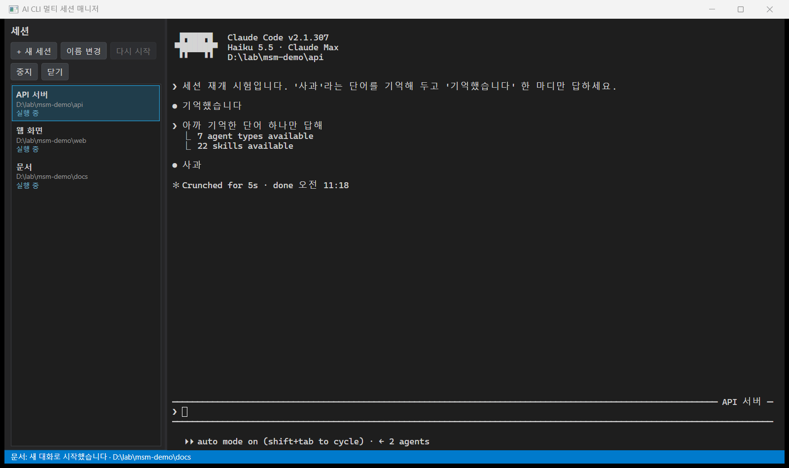
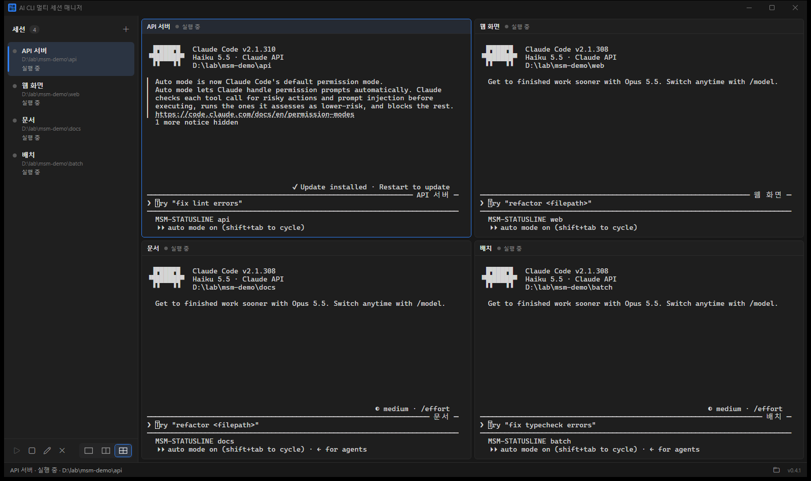

# AI CLI 멀티 세션 매니저

Claude Code 를 여러 개 띄우면 PowerShell 창이 금방 대여섯 개가 됩니다.
어느 창이 어느 폴더였는지, 어제 하던 대화가 어느 것이었는지 찾다 보면 작업보다 창 정리에 시간이 더 갑니다.

이 프로그램은 그 창들을 한 화면의 세션 목록으로 모읍니다.
세션마다 이름과 폴더가 붙고, 앱을 껐다 켜도 세션마다 **같은 대화로** 이어집니다.



> 지금은 0.3.0, 3단계(창 복원·종료 정리)까지 만든 상태입니다. Windows 10 1809 이상, Windows 전용입니다.

## 할 수 있는 것

- 폴더를 골라 Claude Code 세션을 엽니다. 이름은 폴더 이름으로 시작하고 언제든 바꿀 수 있습니다
- 세션마다 독립된 터미널(ConPTY)이 붙어 입출력이 섞이지 않습니다
- 화면을 1·2·4칸으로 나눠 세션 여러 개를 한 번에 봅니다. 칸막이는 끌어서 넓히고 좁힐 수 있습니다
- 앱을 다시 켜면 창 위치·크기·최대화, 칸 배치와 칸막이 위치가 그대로 돌아오고, 보이는 세션은 이전 대화로 이어서 뜹니다
- 저장한 창 위치가 지금 화면 밖이면(모니터를 뺀 경우) 보이는 곳으로 옮겨 띄웁니다
- 중지 · 다시 시작 · 닫기. 닫아도 Claude 쪽 대화 기록은 지우지 않습니다
- 앱을 닫으면 Claude 를 사용자가 나가는 것과 같은 길(Ctrl+C)로 끝냅니다. 그래서 Claude 의 SessionEnd 훅도 돕니다
- 앱이 어떻게 끝나든(강제 종료 포함) 띄운 claude 프로세스가 남지 않습니다

입력 대기 알림, Codex·Gemini CLI 는 아직 없습니다. 아래 [단계](#단계)에 순서를 적어 두었습니다.

## 설치와 실행

필요한 것은 세 가지입니다.

| 준비물 | 확인 방법 |
|---|---|
| Claude Code (`claude` 가 PATH 에 있어야 합니다) | `claude --version` |
| .NET 9 SDK | `dotnet --list-sdks` |
| WebView2 런타임 (Windows 11 은 기본 설치) | 없으면 첫 실행 때 상태줄에 안내가 뜹니다 |

```powershell
git clone <이 저장소>
cd 01_multsessionmanager
dotnet run --project src/MultiSessionManager
```

시험은 `dotnet test` 로 돌립니다. 실제 ConPTY 를 띄우는 시험이 들어 있어 Windows 에서만 돕니다.

실행 파일 하나로 쓰려면 단일 파일로 게시합니다. .NET 을 따로 설치하지 않아도 되고, 측정한 PC 에서는 일반 빌드보다 앱이 2~3배 빨리 떴습니다.

```powershell
dotnet publish src/MultiSessionManager -p:PublishProfile=win-x64   # → publish\win-x64\MultiSessionManager.exe (약 130MB)
```

## 쓰는 법

| 하고 싶은 것 | 방법 |
|---|---|
| 새 세션 | **[+ 새 세션]** 또는 `Ctrl+Shift+T` → 폴더 선택 |
| 이름 바꾸기 | 목록에서 더블클릭, `F2`, 또는 **[이름 변경]** |
| 복사 | 글자를 드래그한 뒤 `Ctrl+C`. 고른 글자가 없으면 `Ctrl+C` 는 그대로 Claude 에 가서 작업을 멈춥니다 |
| 붙여넣기 | `Ctrl+V` |
| 대화 이어 가기 | 멈춘 세션을 고르고 **[다시 시작]** |
| 화면 나누기 | **[1칸] [2칸] [4칸]** 또는 `Ctrl+Alt+1` · `2` · `4`. 터미널을 쓰는 중에도 됩니다 |
| 칸 고르기 | 칸을 누르면 파란 테두리가 옮겨 가고, 왼쪽 목록 선택도 따라옵니다 |
| 다른 세션을 칸에 넣기 | 칸을 고른 뒤 목록에서 세션을 누릅니다. 이미 다른 칸에 떠 있으면 그 칸으로 옮겨 갑니다 |
| 칸 크기 | 칸 사이의 막대를 끕니다 |

2칸·4칸으로 늘리면 아직 안 보이던 세션이 목록 순서대로 채워지고, 칸에 보이는 세션은 그때 자동으로 뜹니다.
줄일 때는 지금 보고 있는(파란 테두리) 세션이 남습니다.

세션 목록·칸 배치·창 위치는 `%APPDATA%\MultiSessionManager\sessions.json` 에 저장됩니다.
실행 기록은 `%LOCALAPPDATA%\MultiSessionManager\logs\` 에 하루 한 파일로 남습니다. 기동 단계별 시간과 오류만 적고, 대화 내용은 적지 않습니다.
녹화나 시연처럼 평소 목록과 떼어 두고 싶을 때는 환경변수 `MSM_STATE_FILE` 로 다른 파일을 지정하면 됩니다.

## 이렇게 동작합니다

```
WPF 창 (세션 목록 · 버튼)
  └ SessionManager ─ 생성 · 이름 변경 · 저장(JSON)
      └ Session ─ ClaudeAdapter 가 만든 명령으로 PseudoConsoleProcess 실행
          └ ConPTY ─ claude.exe          ← 세션마다 하나, 모두 Job Object 안
  └ WebView2 하나 ─ 세션마다 xterm.js 인스턴스 하나
```

몇 가지는 일부러 이렇게 정했습니다.

- **세션 ID 는 앱이 먼저 정합니다.** `claude --session-id <UUID>` 로 띄우고, 다음에는 같은 값으로 `--resume` 합니다. CLI 화면을 읽어 ID 를 알아낼 필요가 없기 때문입니다
- **대화 파일이 있을 때만 재개합니다.** 띄우기만 하고 아무 말도 안 한 세션은 파일이 없어서, 그대로 `--resume` 하면 실패합니다
- **WebView2 는 하나만 씁니다.** 세션마다 따로 두면 브라우저 프로세스가 늘어나기 때문입니다
- **세션 시작은 UI 스레드 밖에서 합니다.** 대화 기록 조회와 프로세스 생성에 세션 하나당 0.5~0.9초가 걸려, 4칸을 한꺼번에 띄우면 그동안 화면이 멈췄기 때문입니다. 지금은 넷이 0.1초 안에 함께 뜹니다
- **가상 호스트 이름은 `msm.example` 입니다.** 처음 쓴 `msm.local` 은 `.local` 이라 이름 조회를 거치느라 페이지 준비가 2.2초 걸렸고, 바꾼 뒤 0.7~1.3초가 됐습니다
- **Job Object 로 묶습니다.** 앱이 죽어도 OS 가 자식·손자 프로세스를 함께 끝내기 때문에 백그라운드에 claude 가 쌓이지 않습니다
- **끌 때 바로 죽이지 않습니다.** 나가는 입력(Claude 는 Ctrl+C) → 콘솔 닫기 → 강제 종료 순으로 기회를 줍니다. 바로 죽이면 Claude 의 SessionEnd 훅이 돌지 않고, 기동 중에 죽이면 Claude 가 전체 화면 렌더러 실패로 기록해 두 번째에는 그 PC 의 모든 세션에서 렌더러를 끕니다
- **바깥 Claude 세션의 환경변수는 지웁니다.** 이 앱을 Claude Code 안에서 띄우면 `CLAUDECODE` 같은 값이 따라오는데, 그대로 두면 자식 claude 가 자기를 중첩 실행으로 여깁니다

기술을 고른 이유와 버린 대안(Go·Tauri·Electron·Python, Monaco 기반)은 [docs/design/01_기술선정_검토.md](docs/design/01_기술선정_검토.md) 에 있습니다.



## 시험

```powershell
dotnet test                                                    # 59건. 실제 ConPTY 를 띄우는 시험 포함
powershell -ExecutionPolicy Bypass -File tools/e2e/phase2.ps1   # 칸 분할 19가지
powershell -ExecutionPolicy Bypass -File tools/e2e/phase3.ps1   # 창 복원·기동 시간 16가지
powershell -ExecutionPolicy Bypass -File tools/e2e/plugins.ps1  # Claude 플러그인·훅·상태줄 8가지
```

`phase3.ps1`·`plugins.ps1` 은 사용자 Claude 설정을 복제한 시험용 설정으로 돕니다. 훅과 상태줄은 기록기로 바꿔 두어 실제 훅이 하는 일(외부 전송 등)은 일어나지 않고,
로그인은 `claude setup-token` 으로 따로 받은 토큰을 씁니다.

E2E 는 칸을 바꿀 때마다 Claude 가 그린 가로줄 길이를 터미널 폭과 대조합니다. 자세한 내용은 [tools/e2e/README.md](tools/e2e/README.md) 에 있습니다.

## 메모리

이 PC(Windows 11, Claude Code 2.1.307)에서 잰 Private 메모리입니다.
세션 하나는 프롬프트 대기, 나머지는 폴더 신뢰 질문 화면에서 잰 값이라 작업 중일 때와는 다릅니다.

| 세션 수 | 앱 본체 | WebView2 (6개 프로세스 합) | claude 합 |
|---|---|---|---|
| 0 | 41.4MB | 162.1MB | - |
| 1 | 31.5MB | 195.8MB | 500.6MB |
| 3 | 32.9MB | 193.4MB | 1,167.6MB |
| 4 (4칸, Release 빌드) | 25.0MB | 195.2MB | 1,527.7MB |

세션을 1개에서 4개로 늘려도 앱과 WebView2 쪽은 거의 그대로입니다. 늘어나는 것은 claude 프로세스 자체입니다.
5·10세션 측정과 장시간 출력 시험은 4단계에서 합니다.

## 단계

| 단계 | 내용 | 상태 |
|---|---|---|
| 1 기반 | 세션 생성 · 이름 · 폴더 · 실행 · 재개 · 프로세스 정리 | 완료 |
| 2 레이아웃 | 1 · 2 · 4칸, 칸막이, 크기 변경, 배치 저장 | 완료 |
| 3 복원 보강 | 창 위치 · 크기 저장, 기동 시간 줄이기, 종료 정리 | 완료 |
| 4 안정화 | 입력 대기 · 완료 표시(Hook), 오류 기록, 반복 생성 · 삭제 시험 | 다음 |
| 5 확장 | Codex · Gemini CLI, Git Worktree, diff 보기 | |

## 알려진 점

- 한글은 Claude Code 와 같은 유니코드 11 폭으로 셉니다. 글꼴(Cascadia Mono)에 한글이 없어 맑은 고딕으로 넘어가기 때문에 한글 글자 사이가 조금 벌어져 보입니다
- 한글 입력은 Chromium 의 조합 이벤트로 시험했습니다. Windows 한글 IME 로 직접 친 결과는 사람이 확인하는 항목으로 남아 있습니다
- 일반 빌드(exe)는 이 PC 에서 앱 코드에 닿기까지 2.6~5.3초 걸렸고, 같은 dll 을 `dotnet` 으로 켜면 훨씬 빨랐습니다. 런타임 DLL 을 여는 구간이 느렸고, 단일 파일 게시본은 0.95~1.5초였습니다. 원인(백신 등)은 확정하지 않았습니다
- 네 칸이 모두 뜨는 시간은 claude 4개의 기동이 좌우합니다. 바쁜 PC 에서는 10~19초까지 걸렸습니다
- 실행 중에 탭 이름을 바꾸면 앱 목록에는 바로 보이지만, Claude 입력칸 테두리의 이름은 다음에 시작할 때 바뀝니다

## 라이선스

MIT. 터미널 화면에 쓰는 [xterm.js](https://github.com/xtermjs/xterm.js) 는 MIT 이고, 라이선스 원문을 `src/MultiSessionManager/Web/vendor/LICENSE-xterm.txt` 에 같이 두었습니다.

이 프로그램은 Anthropic 의 공식 도구가 아닙니다.
